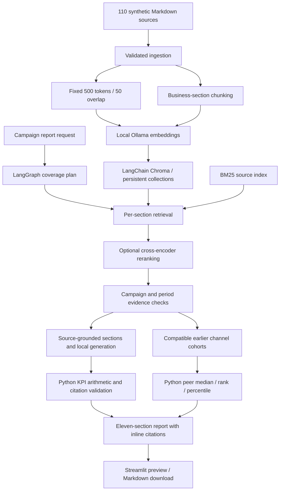

# Architecture

Chroma stores chunk text, vectors, and source metadata. It does not generate answers. LangChain's OllamaEmbeddings converts source text/questions into embeddings; ChatPromptTemplate and ChatOllama structured-output chains provide generation. LangChain Chroma performs vector search. BM25 complements vector search for exact identifiers and terminology. Report sections use independent retrieval queries rather than sharing only five chunks for a whole report.

Direct mail uses 60 days from mail/drop date; display uses 30 days from exposure. Historical comparisons use retrieved channel outcome tables and require compatible product/channel/measurement rules, an earlier reporting period, and mature attribution windows. The UI and report show peer-level evidence, medians, ranks, and direction-aware performance percentiles.

Generated reports remain outside the ingestion manifest. This prevents output text becoming circular evidence. Source access is limited to manifest paths. Historical evidence is explicitly labeled and cannot supply the selected campaign's KPI actuals.
