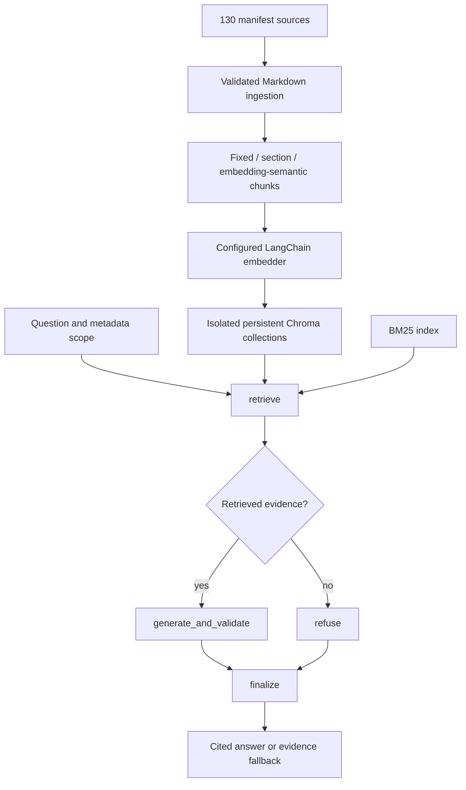

# Architecture

Campaign Intelligence Hub is a question-answering RAG framework for a campaign knowledge base. The bundled fictional library demonstrates the ingestion contract; an owner can adapt the source metadata and validation contract for another campaign library. It is not an exact reproduction of the SEC filings tutorial dataset.

The immutable sample contains 130 Markdown documents: four linked documents for each of 20 campaigns, 30 shared guides, 12 original longer learning guides, and eight requirements-pack sources. A manifest records document metadata and source hashes. Only validated manifest sources enter the index.

The executable LangGraph is [rag/workflow.py](../src/campaign_hub/rag/workflow.py). Its `retrieve` node applies query analysis and retrieval settings, then branches to `generate_and_validate` when hits exist or `refuse` otherwise. `finalize` returns the analysis, answer, workflow steps, retrieval duration and total latency. Retrieved hits may still be insufficient: generation can return no accepted claims and therefore the same fallback.

Dense search uses Chroma; hybrid search combines dense and BM25 chunk rankings using reciprocal rank fusion. Optional cross-encoder reranking selects from the candidate pool. Explicit metadata constraints bind retrieval; optional classification can add compatible constraints. The UI exposes Ask Questions, Analyst View, Chunking Lab and Evaluation.

Generation uses a structured LangChain provider interface with Ollama by default and optional OpenAI or Groq. Narrow factual questions first use complete, hash-verified retrieved objective sections or reconciled actual-count tables. Count projections retain raw source rows, headers and source IDs; their rendered text is derived from cells rather than required to be verbatim. Broader model answers require existing retrieved chunk IDs and verbatim text from every cited chunk. An omitted citation can be recovered only from a unique exact match among retrieved sources; incorrect explicit IDs and ambiguous matches remain rejected. This conservative validation prevents unsupported paraphrases from being accepted, but does not establish relevance or independent semantic entailment. Chroma stores evidence and vectors; it does not generate answers.

Index compatibility includes corpus, embedding and chunking identities. Evaluation adds the question-set and generation identities so stale measurements cannot appear as current. See [methodology](methodology.md), [chunking comparison](chunking-comparison.md) and [measured evaluation results](evaluation-results.md).
