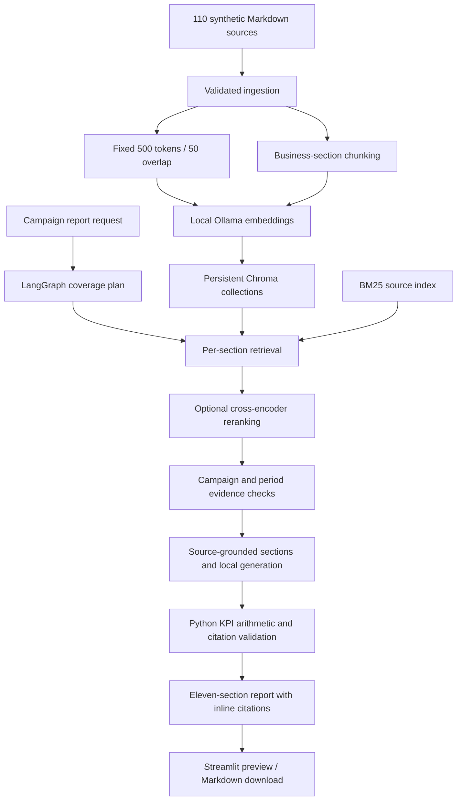

# Architecture

Chroma stores chunk text, vectors, and source metadata. It does not generate answers. Local Ollama converts source text/questions into embeddings and optionally generates structured prose. BM25 complements vector search for exact identifiers and terminology. Report sections use independent retrieval queries rather than sharing only five chunks for a whole report.

Generated reports remain outside the ingestion manifest. This prevents output text becoming circular evidence. Source access is limited to manifest paths. Historical evidence is explicitly labeled and cannot supply the selected campaign's KPI actuals.
