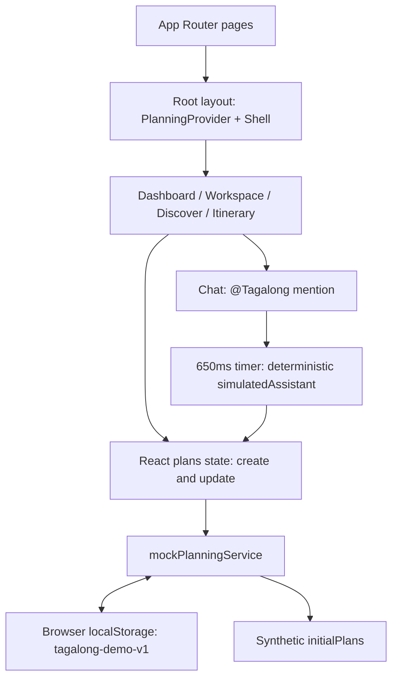

# Family Decision Desk: Tagalong architecture audit

> Historical snapshot from the Groups contribution on main (`895593a`). It describes the older prototype and its original verification. The current connected app and integration checks are documented in [Tagalong release status](../tagalong/docs/CONNECTED_STATUS.md) and [Groups integration plan](../tagalong/docs/superpowers/plans/2026-11-06-groups-integration.md).

**Observed — scope:** This audit covers `tagalong/`, confirmed by the user on November 6, 2026. Evidence links below are relative to this document. Existing application files were inspected only; no app, dependency installation, tests, builds, migrations, or external APIs were executed. This document and its companion gap analysis describe static evidence, not a verified release. The prototype itself declares its boundaries in [README](../tagalong/README.md:32).

**Observed — evidence convention:** “Observed” describes repository contents; “Inferred” identifies assessment, anticipated behavior, or proposed design. A missing implementation means none was found in the inspected Tagalong source/configuration inventory below, not that another workspace project cannot contain similar code. Future integrations in [README:45](../tagalong/README.md:45) are intentions, not implemented architecture.

## Inventory

**Observed — tree:** The inspected Tagalong tree is:

```text
tagalong/
  AGENTS.md, README.md, VERIFICATION.md, .env.example, .gitignore
  package.json, package-lock.json
  tsconfig.json, next-env.d.ts, eslint.config.mjs
  postcss.config.mjs, playwright.config.ts
  src/
    app/{layout.tsx,globals.css,page.tsx}
    app/{welcome,discover,itinerary}/page.tsx
    app/plans/[id]/page.tsx
    components/{shell,brand}.tsx, ui/{button,dialog}.tsx
    features/planning/{store,create-plan,dashboard,landing,workspace,
                       board,polls,discover,itinerary,shared}.tsx
    services/{types.ts,demo-data.ts,mock-planning-service.ts}
    lib/utils.ts
  public/images/{coast,restaurant,forest}.jpg
  tests/planning.spec.ts
  docs/superpowers/plans/2026-11-04-tagalong.md
```

**Observed — stack:** TypeScript/TSX, CSS, JSON and JavaScript-module configuration; Next.js App Router, React, Tailwind/PostCSS, Radix Dialog/Slot, lucide-react, clsx and class-variance-authority. Manifest ranges include Next `^16.4.5`, React `^19.3.1`, TypeScript `^6.0.3`, Playwright `^1.64.1`; these are declared ranges, not runtime verification. npm has a v3 lockfile. [package.json:5–38](../tagalong/package.json:5), [package-lock.json:1–34](../tagalong/package-lock.json:1), [PostCSS](../tagalong/postcss.config.mjs:1).

**Observed — build/CI/deployment:** npm scripts invoke `next dev`, `next build`, `next start`, `eslint .`, `tsc --noEmit`, and `playwright test`. TypeScript is strict, uses the `@/*` alias, and enables incremental checking; ESLint uses Next core-web-vitals and TypeScript presets. No Tagalong Dockerfile, hosting manifest, custom Next config, database migration, backend folder, or CI workflow was found in the inventory above; none is supplied by its scripts. A Next start script alone does not establish a deployed environment. [package.json:5–11](../tagalong/package.json:5), [tsconfig](../tagalong/tsconfig.json:1), [ESLint](../tagalong/eslint.config.mjs:1).

**Observed — environment names only:** `.env.example` declares `NEXT_PUBLIC_SUPABASE_URL`, `NEXT_PUBLIC_SUPABASE_ANON_KEY`, `FASTAPI_BASE_URL`, `OPENAI_API_KEY`, `GOOGLE_CLIENT_ID`, `GOOGLE_CLIENT_SECRET`. The Playwright configuration reads `CI`. No application environment reads were found in `src/`; these names are future configuration, not evidence of active services. Private env files were not inspected. Ignore rules exclude env variants while allowing the template. [.env.example:2–8](../tagalong/.env.example:2), [Playwright:2](../tagalong/playwright.config.ts:2), [.gitignore:4–5](../tagalong/.gitignore:4), [README:43–45](../tagalong/README.md:43).

**Observed — existing docs:** README covers startup, features, boundaries and future integrations; VERIFICATION records earlier checks; AGENTS specifies local conventions; the Phase 1 plan describes intended tasks and review criteria. Its unchecked tasks are not proof of missing code. [README](../tagalong/README.md:1), [VERIFICATION](../tagalong/VERIFICATION.md:1), [AGENTS](../tagalong/AGENTS.md:1), [plan](../tagalong/docs/superpowers/plans/2026-11-04-tagalong.md:1).

## Components and flows

**Observed — current diagram:** The arrows represent local imports and calls, not network services. [layout:3–6](../tagalong/src/app/layout.tsx:3), [store:8](../tagalong/src/features/planning/store.tsx:8), [mock service:5–10](../tagalong/src/services/mock-planning-service.ts:5).



**Observed — lifecycle:** Provider initializes synthetic plans, asynchronously loads browser storage, then enables persistence. UI updates replace a matching plan through a callback and save the entire array. Load performs a shallow shape check and falls back to seeds; save errors are swallowed. There is no storage-event listener, transaction or network synchronization. [store:6–9](../tagalong/src/features/planning/store.tsx:6), [mock service:3–8](../tagalong/src/services/mock-planning-service.ts:3).

**Observed — creation and planning:** Creation accepts title, outing/trip, dates and comma-separated participant names, generates a UUID, supplies default budget/location/tasks and a date poll. Chat appends a message as Alex; mentions trigger a local assistant response and deduplicated proposed preference labels. Board confirmation flips a boolean; votes overwrite `votes.Alex`; a unique date leader is presented as proposed. Discover filters three static suggestions and copies an idea into the itinerary at 6 PM; custom activities and task checkboxes are local edits. [create-plan:9](../tagalong/src/features/planning/create-plan.tsx:9), [mock service:8](../tagalong/src/services/mock-planning-service.ts:8), [workspace:18](../tagalong/src/features/planning/workspace.tsx:18), [board:8](../tagalong/src/features/planning/board.tsx:8), [polls:8](../tagalong/src/features/planning/polls.tsx:8), [discover:10](../tagalong/src/features/planning/discover.tsx:10), [itinerary:10](../tagalong/src/features/planning/itinerary.tsx:10).

| Observed route | Component and behavior | Evidence |
| --- | --- | --- |
| `/` | Dashboard: plans, filters, creation dialog, synthetic catch-up | [page](../tagalong/src/app/page.tsx:1), [dashboard:10](../tagalong/src/features/planning/dashboard.tsx:10) |
| `/welcome` | Landing page | [page](../tagalong/src/app/welcome/page.tsx:1) |
| `/discover` | Standalone synthetic suggestion browser and plan picker | [page](../tagalong/src/app/discover/page.tsx:1), [discover:10](../tagalong/src/features/planning/discover.tsx:10) |
| `/itinerary` | Links to each plan's draft itinerary | [page](../tagalong/src/app/itinerary/page.tsx:1), [itinerary:11](../tagalong/src/features/planning/itinerary.tsx:11) |
| `/plans/[id]` | Async route params, Suspense, browser-local lookup; optional `?tab=Itinerary` etc. | [page](../tagalong/src/app/plans/[id]/page.tsx:1), [workspace:17](../tagalong/src/features/planning/workspace.tsx:17) |

**Observed — API and auth:** There are no application API endpoints, route handlers, server actions, authentication middleware, login flow, sessions or authorization policies in this inventory. Pages render the mock UI; the workspace finds an ID in local state. “Alex’s space” and the Alex voter/message author are hardcoded presentation/identity. Invite adds a local name and explicitly sends nothing. [shell:10](../tagalong/src/components/shell.tsx:10), [workspace:17–18](../tagalong/src/features/planning/workspace.tsx:17), [polls:8](../tagalong/src/features/planning/polls.tsx:8), [README:34–45](../tagalong/README.md:34).

**Inferred — sharing implication:** A URL for a newly created plan will not make that plan accessible from another browser; a seed ID can show a separate copy of demo data. No-account participation is therefore not yet implemented as a shared link capability. This is a missing boundary, not an observed insecure server endpoint. [workspace:17](../tagalong/src/features/planning/workspace.tsx:17), [mock service:6–8](../tagalong/src/services/mock-planning-service.ts:6).

## Data and AI

| Observed model | Fields and relationships | Evidence |
| --- | --- | --- |
| Plan | ID, title, kind, location, display date, start/end, numeric per-person budget, image; embeds all child collections | [types:8](../tagalong/src/services/types.ts:8) |
| Member / Message | Member name and color; message ID, author string, text, display time, assistant flag; author is not a foreign key | [types:3–4](../tagalong/src/services/types.ts:3) |
| Preference / Poll | Label+confirmed; poll ID, question, string options, name-to-option-index votes, optional date flag | [types:5–6](../tagalong/src/services/types.ts:5) |
| Activity / Task | Activity ID/title/time/category/location/optional image; task label+done | [types:7–8](../tagalong/src/services/types.ts:7) |
| Suggestion | ID/title/category/location/description/price/rating/image/tag; no citation or retrieved-at fields | [types:10](../tagalong/src/services/types.ts:10) |

**Observed — persistence/access:** No SQL tables, migrations, row-level rules, indexes or vector namespaces exist in Tagalong. The data model is nested TypeScript interfaces serialized under one localStorage key; `PlanningService` exposes load/save/create, while mutations remain in UI/provider callbacks. [types:3–12](../tagalong/src/services/types.ts:3), [store:8](../tagalong/src/features/planning/store.tsx:8), [mock service:3–8](../tagalong/src/services/mock-planning-service.ts:3).

**Observed — AI pipeline:** `AssistantService.reply` is synchronous, returns text and proposed preferences, and uses food-related regex matching and a dollar-number regex. There are no agent graphs, model calls, tool registries, system prompts, model state/checkpoints, embeddings, vector indexes, namespaces, chunking, retrievers, research fetches, queues or scheduled workers. LangGraph/OpenAI are documented future work. The 650ms reply delay and 4500ms toast expiry are UI timers, not jobs. [types:12](../tagalong/src/services/types.ts:12), [mock service:10](../tagalong/src/services/mock-planning-service.ts:10), [workspace:18](../tagalong/src/features/planning/workspace.tsx:18), [store:8](../tagalong/src/features/planning/store.tsx:8), [README:45](../tagalong/README.md:45).

## Run and verification plan — not executed

**Observed — documented commands:** From `tagalong/`, README requests Node 22 LTS or newer, `npm ci`, then `npm run dev` at localhost:3000. Production commands are `npm run build` then `npm start`. Browser setup is `npx playwright install chromium`. Installing dependencies/browser binaries, launching processes or executing checks requires user approval in this audit; none occurred. [README:7–16,47–55](../tagalong/README.md:7), [package.json:5–11](../tagalong/package.json:5).

| Observed check | Inferred expectation / limitation | Evidence |
| --- | --- | --- |
| `npm run lint` | Earlier pass is encouraging; fresh result unknown | [VERIFICATION:5](../tagalong/VERIFICATION.md:5), [ESLint](../tagalong/eslint.config.mjs:1) |
| `npm run typecheck` | Earlier pass; fresh dependency/compiler state unverified; incremental check can write tsbuildinfo | [VERIFICATION:6](../tagalong/VERIFICATION.md:6), [tsconfig](../tagalong/tsconfig.json:1) |
| `npm run build` | Treat as unresolved: prior Turbopack sandbox failure and webpack TypeScript-config parse failure may recur | [VERIFICATION:7–8](../tagalong/VERIFICATION.md:7) |
| `npm test` | Three scenarios × desktop/mobile Chromium = six configured cases; needs browser binaries and a dev server. Prior server binding failure prevented acceptance verification | [tests:3–59](../tagalong/tests/planning.spec.ts:3), [Playwright:2](../tagalong/playwright.config.ts:2), [VERIFICATION:9–11](../tagalong/VERIFICATION.md:9) |

**Observed — coverage:** Scenarios cover trip creation/chat/voting/refresh, discovery/itinerary/preference confirmation/navigation, and empty-plan rejection/custom poll vote replacement. No unit tests, API tests, multi-browser collaboration tests, security-policy tests, ICS tests or research/approval integration tests are present in `tests/`. Retained failure traces are enabled. [tests](../tagalong/tests/planning.spec.ts:1), [Playwright](../tagalong/playwright.config.ts:2).

**Inferred — useful future checks:** After approval, validate the clean lockfile install, lint/typecheck/build and six browser cases, then inspect actual results before promising readiness. Add tests for each new trust boundary rather than tests that duplicate UI code. Use synthetic data in traces. The current suite cannot establish multi-user or security correctness. [tests](../tagalong/tests/planning.spec.ts:1), [VERIFICATION:11–13](../tagalong/VERIFICATION.md:11).

## Top ten risks and proposed refactors

**Inferred — ranking:** Severity below reflects the target product, not a claim that the local demo currently performs live actions. Size estimates and sequencing are in [gap-analysis](gap-analysis.md).

| Rank | Observed evidence | Inferred risk and proposed response |
| --- | --- | --- |
| 1 | Local-only load/save; hardcoded Alex [mock:6–8](../tagalong/src/services/mock-planning-service.ts:6), [polls:8](../tagalong/src/features/planning/polls.tsx:8) | Critical to shared launch: no group identity/isolation boundary. Establish owner access plus expiring, scoped, revocable participant links and authorize every future read/write, including realtime subscriptions. Test cross-plan denial and vote uniqueness. |
| 2 | Names and arbitrary chat persist in localStorage; no retention fields [types:3–8](../tagalong/src/services/types.ts:3), [mock:7](../tagalong/src/services/mock-planning-service.ts:7), [workspace:17–18](../tagalong/src/features/planning/workspace.tsx:17) | High: users can enter children's names or sensitive details despite demo copy. Use adult aliases, aggregate child counts/age bands if needed, prohibit child identifiers/photos, define deletion/retention and minimize stored free text. No upload UI exists, but arbitrary text remains a data path. |
| 3 | Suggestion prices/ratings lack provenance [types:10](../tagalong/src/services/types.ts:10), [demo-data:3–6](../tagalong/src/services/demo-data.ts:3) | High: cannot support researched decisions. Introduce claim-level URL, excerpt, retrieval timestamp and freshness/unknown markers; keep synthetic examples separate. |
| 4 | No outbound/spend integration; only preference confirmation [README:34,45](../tagalong/README.md:34), [board:8](../tagalong/src/features/planning/board.tsx:8) | High before integrations: no enforceable action approval. Require server-side approval bound to exact recipient/content or amount/vendor, expiry and idempotency; edits invalidate approval. A preference click is insufficient. |
| 5 | Full-array writes, shallow validation, silent storage failures [mock:6–7](../tagalong/src/services/mock-planning-service.ts:6) | High reliability: malformed nested data can break rendering, tabs can overwrite each other, quota failures can look saved. Add runtime schemas, versioned migration, per-plan commands, conflict handling and visible persistence failures. |
| 6 | Poll mutable votes, no close/final decision; no event entity [types:4–8](../tagalong/src/services/types.ts:4), [polls:8](../tagalong/src/features/planning/polls.tsx:8) | High integrity: no durable explanation of who decided what. Add decision snapshots and append-only events, committed atomically with mutations; redact log content. |
| 7 | Earlier unresolved build and no completed browser run [VERIFICATION:7–11](../tagalong/VERIFICATION.md:7) | High delivery: production packaging and core flows unverified. Reproduce after approval, fix evidenced failures, then add CI with isolated synthetic fixtures. |
| 8 | No real AI/research path [mock:10](../tagalong/src/services/mock-planning-service.ts:10), [README:45](../tagalong/README.md:45) | Future high security: retrieved text could inject instructions once research exists. Treat it as untrusted data; constrain tools, validate outputs and URL fetching, block private-network destinations/unsafe redirects, and never allow retrieved content to authorize actions. No current model vulnerability is asserted. |
| 9 | No provider execution, budgets or cache [mock:10](../tagalong/src/services/mock-planning-service.ts:10), [types:11–12](../tagalong/src/services/types.ts:11) | Future high cost/reliability: add per-plan/user call and token caps, timeout/retry limits, cancellation, provenance-aware cache and usage telemetry before enabling paid calls. Current application AI API spend is absent. |
| 10 | Display dates/time strings, scalar budget, no currency/timezone fields [types:6–8](../tagalong/src/services/types.ts:6), [mock:4,8](../tagalong/src/services/mock-planning-service.ts:4) | Medium/high correctness: ambiguous calendar times and no ledger reconciliation. Model UTC instants plus IANA timezone, currency and integer minor units; validate dates/amounts server-side, test DST and split rounding. |

**Observed — secret/rendering posture:** Future secret names exist only in the template; ignore rules reduce accidental env commits but do not prove history is secret-free. Chat content is rendered as React text, with no raw HTML sink found in inspected source. No credential/history scan was run. [workspace:18](../tagalong/src/features/planning/workspace.tsx:18), [.gitignore:4–5](../tagalong/.gitignore:4), [.env.example](../tagalong/.env.example:2).

**Inferred — architecture recommendation:** Preserve route/view boundaries and the synthetic adapter, but replace whole-array save and synchronous reply contracts with validated asynchronous domain commands. Separate plan, participant response, poll, evidence, decision, booking packet, ledger and event services. Select a backend only after agreeing the access model; Supabase/FastAPI are documented candidates, not a requirement to deploy both. A vector database or agent graph should follow a demonstrated retrieval/orchestration need rather than be a prerequisite. [types:11–12](../tagalong/src/services/types.ts:11), [README:45](../tagalong/README.md:45).
