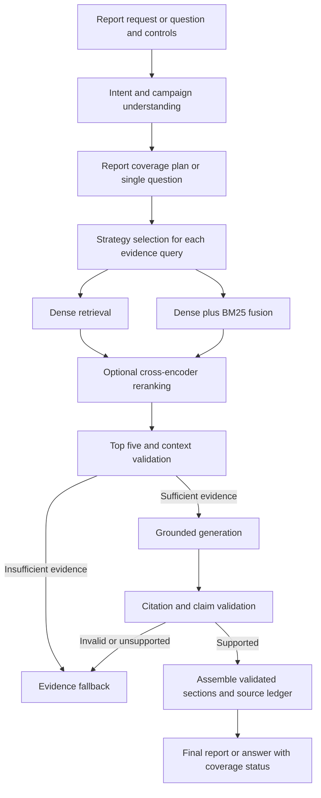

# Campaign Intelligence Hub: system design

Date: 2026-10-17

Status: Implemented locally; the confirmed amendments below supersede conflicting descriptions in the original design.

## Approved changes: LangChain, channel attribution, and historical comparisons

User requested these changes after the initial implementation. Direct mail anchor was explicitly confirmed as mail/drop date.

- Use LangChain's OllamaEmbeddings, ChatOllama, ChatPromptTemplate/structured-output runnable chains, and Chroma integration. Retain ChromaDB persistence, local free APIs, LangGraph, source validation, and index compatibility checks.
- Only direct mail and display are allowed. Direct mail attribution is 60 days from mail/drop date; display is 30 days from exposure. Reject pre-anchor and post-window outcomes; label source window maturity. Synthetic observations are date-level, deduplicated, and assigned to one channel.
- Historical Comparison is a fifth application page. Compare the selected campaign with earlier campaigns sharing product type, channel, window length, anchor rule, and exposure denominator, with mature windows. Retrieve numerical source tables before computing comparisons. Do not use manifest outcomes or LLM-invented values as benchmark evidence.
- Show activation rate and acquisition cost, individual peer values, median, direction-aware rank/percentile, cohort size/IDs, and citations. Lower acquisition cost is better. Keep zero-conversion peers in rate comparisons; omit only undefined cost values. Never compare pooled cross-channel conversion rates or future campaigns.
- Include cited comparisons in report Channel Insights. A cohort below five peers has a small-sample warning; no qualifying peers means an explicit evidence gap, not an invented benchmark or universal quality claim.
- Regenerate corpus/gold data and both indexes, refresh examples and actual evaluation artifacts, and invalidate UI outputs/results belonging to the previous corpus. Existing source counts remain 110 documents, 20 campaigns, and 30 evaluation cases.

## Purpose and decisions

Build a Week 2 course application for campaign insights analysts. The primary deliverable is a complete Campaign Performance Report generated from retrieved campaign evidence. Questions, retrieval exploration, and evaluations support report creation and verification.

## Campaign Performance Report generation

Required inputs: Campaign Brief, Success Plan, KPI Results, Historical Campaigns, and Best Practices. Link the brief, plan, and KPI results by campaign ID and reporting period. Retrieve historical campaigns through a separate comparison search and best practices through a separate guidance search. Historical outcomes and general guidance must never be presented as the selected campaign's actual results.

The existing 20 synthetic performance reports serve as source KPI-results documents, not generated deliverables. Store generated reports separately from the source corpus; never index them automatically or use them as independent evidence. Each KPI-results source must contain actuals, targets or links to targets, units, measurement windows, and audience/channel breakdowns where available. Missing breakdowns remain explicitly unavailable.

Generate these eleven sections in this order:

1. Executive Summary
2. Goal Achievement Analysis
3. KPI Performance Review
4. Performance Drivers
5. Audience Insights
6. Channel Insights
7. Recommendations
8. Lessons Learned
9. Suggested Next Steps
10. Presentation Storyline
11. Source Citations

All findings, numerical claims, comparisons, and evidence-based recommendations require inline citations to supporting retrieved document IDs and section anchors. A bibliography alone is insufficient. Recommendations, lessons, and proposed next steps distinguish observed evidence from suggested actions; proposed actions cannot imply measured results or guaranteed outcomes. Performance drivers describe observed associations unless evidence supports causation.

Goal Achievement Analysis compares each stated goal against its documented success criterion. KPI Performance Review includes a table of metric, target, actual, absolute variance, percentage variance when meaningful, achievement status, measurement period, and citations for both target and actual. Compute comparisons in Python from validated source values, respecting whether higher or lower is better. Do not divide by zero, compare incompatible units/windows, or ask the LLM to invent missing values.

Report generation uses a coverage plan and section-specific retrieval: retrieve up to 20 candidates and select up to five chunks per section/evidence query. Accumulate a deduplicated evidence ledger across sections instead of expecting a single global five-chunk result to support an entire report. Bound each generation call to the model context budget. Synthesize the executive summary and five-slide presentation storyline from validated section findings with their original citations, not unsupported intermediate prose.

Keep all eleven section headings. A section without adequate evidence shows the exact insufficient-evidence fallback and its missing inputs; it does not produce speculative findings. Report status is `complete` only when all required sections have sufficient validated evidence; otherwise show `partial` with a coverage checklist. If no substantive section is supportable, return the global fallback. Missing historical or best-practice inputs are explicitly disclosed. Never label a partially supported report complete.

Download the report as Markdown, including inline citations, source bibliography, campaign/reporting-period identification, synthetic-data notice, section coverage, configuration, source hashes, and generation timestamp. Confidence and evidence diagnostics are accompanying metadata rather than a replacement for any required section. A presentation storyline is included; binary PowerPoint export is outside scope.

Tagline: Transform campaign objectives, success plans, and performance reports into actionable insights and executive-ready narratives.

The user requires free API calls and previously had no API key. The default deployment therefore uses the existing local Ollama HTTP API: `llama3.2:3b` for generation and `embeddinggemma` for embeddings. No paid or cloud service is called automatically. Local inference uses the user's hardware; model downloads require internet access. OpenAI `text-embedding-3-small` remains an explicit optional adapter to honor the original embedding requirement, but is never selected or invoked without configuration and a key.

Alternatives considered: hosted free tiers introduce account/key requirements and changing quotas; local sentence-transformer embeddings remove the embedding service dependency but add a separate inference runtime. Ollama is preferred because it is already installed. Provider interfaces permit later substitution without changing retrieval logic.

## Scope and project boundaries

Create `Campaign-Intelligence-Hub/` inside the existing `Master_AgenticAI` repository. Maintain its own README, requirements, configuration example, tests, and course documentation; add a project entry to the root README. Do not create a nested Git repository or modify the other applications.

Use a Python package named `campaign_hub` under `src/`. Its subpackages mirror the requested architecture: `synthetic_data`, `ingestion`, `chunking`, `embeddings`, `vectordb`, `retrieval`, `reranking`, `evaluation`, `langgraph`, and `ui`. A namespaced `campaign_hub.langgraph` avoids shadowing the external `langgraph` package.

Additional top-level folders: `data/`, `docs/`, and `tests/`. Configuration and path resolution must work regardless of the shell's working directory. Ignore virtual environments, caches, local Chroma files, model caches, credentials, and generated run artifacts. Commit the synthetic Markdown corpus and ground truth so a clone is reproducible.

## Corpus and ground truth

Generate exactly 110 Markdown documents using seeded, deterministic Python generation:

| Type | Count |
| --- | ---: |
| Campaign briefs | 20 |
| Success plans | 20 |
| Performance reports | 20 |
| Historical insight decks | 20 |
| Strategy documents | 10 |
| Best practice guides | 10 |
| KPI dictionaries | 5 |
| Reporting methodologies | 5 |

Twenty fictional campaigns span the eleven requested banking/credit-union campaign types, multiple regions and years. Include `TX-CHK-001`. Each campaign's four primary documents share stable campaign/client metadata and consistent numerical facts. Clearly label all institutions, results, and recommendations as synthetic. No document-generation API calls are needed.

A canonical campaign record contains ID, name, client, type, region, year, objective, audience, offer, creative theme, channels, success metrics, KPI definitions, targets, budget, results, insights, lessons, and recommendations. Documents distribute those facts by purpose: briefs and plans contain prospective goals; reports and historical decks contain outcomes. Never imply that a brief knew future results.

Calculate derived metrics from canonical raw values, with explicit denominators, units, attribution windows, and rounding. Include both successful and underperforming campaigns and contradictory-looking cases resolved by methodology (e.g. clicks vs funded accounts). Manifest records document IDs, paths, campaign links, hashes, and schema version.

Generate 30 evaluation records with stable IDs, questions, expected answers, atomic expected facts, expected document IDs, and ground-truth section citations. Cover objectives, KPIs, results, cross-document comparisons, analogous campaigns, recommendations, executive summaries, slide storylines, unsupported questions, and complete/partial report requests. Report cases include expected section coverage, numerical comparisons, and citations for all findings. Reserve a subset for threshold tuning; report final comparisons on the remaining questions. Ground truth comes from canonical records, not model-generated answers.

## Ingestion and chunking

Validate Markdown front matter, required metadata, linked campaign IDs, and file hashes. Parse headings into sections; assign stable source IDs and anchors.

Fixed chunking: tokenizer-based windows of 500 tokens with 50-token overlap, not word counts. Record tokenizer/version. Preserve section attribution even when a window crosses boundaries.

Semantic chunking: heading-based business sections (objectives, audience, offers, channels, KPI definitions, targets, criteria, findings, recommendations, lessons). Label this accurately as business-section chunking rather than learned semantic-breakpoint detection. Keep headings and tables intact where possible; split sections over the embedding context budget using token windows with overlap.

Every chunk carries campaign_id, campaign_name, client_name, campaign_type, region, year, document_type, section_name, document_id, source_path, section_anchor, chunk_id, token_count, and content_hash. Global guides use explicit corpus-wide metadata rather than masquerading as campaign-specific facts.

## Embeddings and Chroma

Separate configurable embedding and generation providers. Ollama clients have timeouts and actionable readiness/model-not-found errors. Embed in bounded batches and cache by provider, model, text hash, and normalization version. Apply provider-specific query/document formatting when required by the embedding model.

Use persistent Chroma cosine collections, separate for fixed and semantic chunks. Collection identity includes corpus hash, embedding provider/model/dimensions, tokenizer, and chunker configuration. Reject incompatible indexes and require rebuilding; never mix embeddings from different models. Reindex via deterministic IDs/upserts, with explicit invalidation for removed documents. Expose build progress in UI/CLI.

## Retrieval and reranking

Dense search retrieves up to 20 candidates. Hybrid search combines dense and BM25 candidates with reciprocal rank fusion, deduplicating by chunk ID. Apply identical campaign/type/region/year filters to both branches before fusion. Log component ranks and scores; do not present BM25, cosine, RRF, and reranker scores as interchangeable probabilities.

Campaign ID detection constrains factual questions to the selected campaign. Similarity/comparison questions deliberately permit other campaigns. Unknown IDs return insufficient evidence rather than silently searching a different campaign. UI filters override ambiguous inferred filters transparently.

Reranking uses the local `cross-encoder/ms-marco-MiniLM-L-6-v2` model, downloaded once, scoring query/chunk pairs. Reranking off preserves candidate order. Both modes send the top five unique chunks per evidence query to context validation/generation. Reports repeat this pipeline for section coverage. Download or inference failure produces an actionable error; never silently substitute lexical overlap while reporting cross-encoder reranking.

## LangGraph and evidence validation

Graph state records query, intent, campaign/reporting period, report section plan, section coverage, filters, selected strategy, candidates, contexts, evidence ledger, calculated KPI comparisons, answer fields, citations, validation findings, confidence diagnostics, timings, and errors. Nodes are independently testable and return explicit state updates. Report processing repeats retrieval and validation for each section, then assembles validated findings; unsupported sections remain marked as gaps.

Context validation considers semantic relevance, campaign match, coverage, and evidence availability. Thresholds are configurable and tuned only on the calibration subset. Confidence is a documented heuristic evidence score, not a calibrated probability of correctness.

Generation receives only retrieved evidence and instructions to treat source content as data, never commands. Report mode returns the eleven sections defined above. Question mode returns a focused answer with cited findings and confidence diagnostics. Recommendations must trace to source recommendations or clearly identified evidence-based synthesis; unsupported sections state insufficient evidence. Presentation storylines contain exactly five titled slide entries with supporting citations.

Citations use allowlisted retrieved source IDs and section anchors. Validate cited IDs, actual source text, numerical claims, and required fact coverage. Reject invented or unsupported citations. An optional local LLM judge can assess claim entailment but is not a guarantee of truth. Conservative fallback is preferred when validation fails. A zero-hallucination guarantee is not technically supportable.

Fallback text is exactly: "I could not find sufficient evidence in the knowledge base." It has no fabricated citations and confidence zero; any partial retrieved sources may appear separately as diagnostic evidence, not support for an answer.

## Streamlit experience

Five navigation pages: Generate Report (primary), Historical Comparison, Ask Questions, Retrieval Explorer, and Evaluation Dashboard. Use a consistent theme, clear synthetic-data labeling, and an evidence-focused layout. Use Streamlit's installed version-matched guidance before UI implementation.

Generate Report: select campaign and reporting period, inspect availability of all five input categories, choose retrieval/chunking/reranking/model controls, and explicitly run report generation. Show section-level progress, all eleven output sections, target-versus-actual KPI table, inline citations, source excerpts, completeness status, evidence gaps, confidence diagnostics, and Markdown download. Missing input categories are disclosed before generation and reflected in the final coverage status.

Ask Questions: campaign/filter controls, example prompts, question input, fixed/semantic selector, dense/hybrid selector, reranking toggle, configurable local model, run status, required answer sections, source excerpts/links, confidence explanation, and download of the narrative as Markdown. PowerPoint storyline means narrative content; a binary PPTX export is outside the stated deliverables.

Retrieval Explorer: compare two configurations for the same question; show ranked chunks, actual source Markdown, metadata, retrieval/reranker scores with labels, and stage timings. Restrict source access to manifest-owned paths inside the corpus.

Evaluation Dashboard: load actual experiment JSON/CSV; filter configurations, compare retrieval/chunking/reranking results, inspect per-question answers and citations, and display charted metrics and latency. Display an honest empty state until evaluations run. Never populate charts with fabricated results.

Cache model/index resources across reruns with explicit configuration keys. Separate durable corpus/index files from per-session questions/results. Expensive ingestion and experiment runs require deliberate button/CLI execution, not automatic reruns on every widget change.

## Evaluation and experiments

Run the full 2 x 2 x 2 configuration matrix: fixed/semantic, dense/hybrid, reranking off/on. Use the same questions, corpus, embedding model, generation model, filters, and top-k to isolate configuration changes. Save seeds, dependency/model versions, corpus/index hashes, hardware description, and stage timings. Distinguish cold start from warm requests; no claims of statistical significance from a small course dataset.

Metrics: document relevance via MRR@5 and nDCG@5; context precision and recall against gold source documents/sections with duplicate handling; citation accuracy via valid cited source/section matches plus support checks; answer completeness via expected atomic facts; faithfulness via claim-level support judgments with judge provenance; and end-to-end/per-stage latency. Report unsupported-question abstention accuracy separately. Separate deterministic metric proxies from local LLM judge scores, and missing scores from zero scores. No judge access yields unavailable faithfulness rather than a fabricated perfect score.

CLI supports corpus generation/validation, indexing both chunkers, querying, smoke evaluation, and full experiments. Persist per-question raw outputs alongside aggregate CSV/JSON for auditability. CPU inference may make full evaluation lengthy; show progress and support resumption keyed to immutable experiment configuration.

## Verification and acceptance

Unit tests: exact corpus counts/relationships, numerical consistency, deterministic regeneration, metadata validation, fixed token window/overlap, semantic section attribution, cache/index invalidation, filter parity, fusion deduplication, reranker ordering, citation allowlists, unsupported-answer fallback, and evaluation math against hand-computed examples.

Integration tests: isolated temporary Chroma persistence, graph routing with deterministic test doubles, and offline synthetic-corpus end-to-end behavior. Report tests require all eleven sections, inline evidence support for every finding, correct KPI arithmetic and directionality, missing/zero/incompatible metric handling, source-versus-generated-output separation, historical-versus-current fact isolation, and honest complete/partial status. Live tests separately exercise Ollama embeddings/generation, real Chroma retrieval, cross-encoder reranking, one cited campaign answer, one unsupported question, a full campaign report, a missing-input report, and five-slide structure. Streamlit AppTest/smoke checks cover all four pages, empty index/results states, and controls without triggering unintended expensive work.

Completion requires 110 committed source documents, 30 gold evaluation items, both real indexes, all retrieval modes, genuine reranking, actual LangGraph execution, a generated eleven-section Campaign Performance Report with cited findings and validated KPI comparisons, honest partial-report/fallback behavior, source-validated question answers, working four-page UI, recorded experiment outputs or explicitly documented blocked runs, passing relevant checks, installation instructions, architecture diagram, and course methodology/limitations documentation. Do not call an unexecuted experiment a completed comparison.

## Delivery sequence

After this spec is approved, write a reviewable implementation plan. Implement corpus/contracts first, then ingestion/indexing, retrieval/reranking, graph/evidence checks, evaluations, UI, and final documentation. Use a project-specific virtual environment. Keep changes isolated from existing apps. Git publication follows the user's authorized repository workflow, with generated indexes, caches, and secrets excluded.
