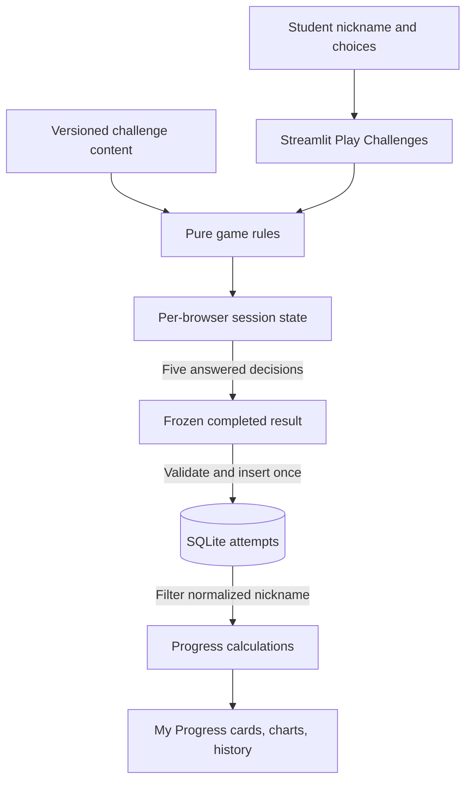
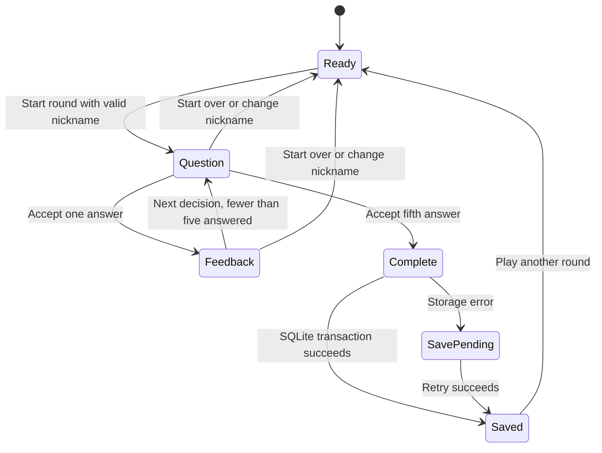

# KidSpark architecture

KidSpark is a local Python learning app. Streamlit handles the two-tab interface;
the `kidspark` package separates question content, game rules, persistence, and
progress calculations so those behaviors can be tested independently.

## Project structure

```text
app.py                       Thin Streamlit launcher
pyproject.toml               Package and dependency metadata
requirements.txt             Editable source installation
.streamlit/config.toml       Purple theme using native Streamlit settings
src/kidspark/
  challenges.py              Historical bank and objective-balanced selection
  question_variants.py       Sixty additional authored question variants
  config.py                  Data paths and database setting
  game.py                    Round state, identity, answer guards, scoring
  storage.py                 SQLite schema, validated writes, history reads
  progress.py                Aggregation and next-challenge recommendation
  metrics.py                 Legacy CSV validation and calculations
  ui/
    app.py                   Tabs and profile/session orchestration
    play.py                  Question, feedback, final result, save retry
    progress.py              Saved-result dashboard
data/missions.csv            Legacy sample data, not displayed by the app
tests/                       unittest and Streamlit AppTest checks
docs/                        Architecture, content, roadmap, verification
```

Install with `python -m pip install -e .` from the project root. The intended
delivery is a source checkout with an editable package installation; data paths
resolve against that checkout rather than the process working directory. A
wheel-only distribution with bundled data is a future packaging enhancement.

## Data flow



Both Streamlit tabs run on each interaction. The play renderer saves completion
before the progress renderer reads history, so a successful final submission
appears on the dashboard in the same run. The sample CSV dashboard has been
removed; legacy CSV calculation utilities remain available offline.

## Round lifecycle



The fifth explanation remains visible alongside the final result. A round fixes
its profile, challenge, level, questions, and start time. Answer widgets use
attempt and question IDs. Rules reject stale question IDs, repeated answers,
and advancement before answering; a UI rerun cannot award points twice.
The UUID seeds reproducible variant selection: one of three questions for each
objective. The introductory objective stays first; the remaining four shuffle.
The selected questions are frozen throughout the round. Choices retain their
authored order. Ninety definitions cover six challenge/level combinations.

Each correct decision earns 20 points; five decisions give a maximum of 100.
Accuracy is correct decisions divided by five, expressed as a percentage.
Hints and duration do not affect points. Completion timestamp and elapsed time
are frozen at the fifth accepted answer. The wall clock supplies UTC timestamps;
a monotonic clock measures elapsed duration.

## SQLite schema and writes

The `attempts` table contains:

| Column | Stored meaning |
| --- | --- |
| `attempt_id` | UUID primary key; prevents duplicate completion records |
| `nickname_key`, `nickname` | Normalized lookup identity and display nickname |
| `challenge`, `level`, `content_version` | Selected round and authored content version |
| `score`, `correct_count`, `question_count`, `accuracy` | Validated result; question count is five |
| `started_at`, `completed_at` | Ordered, timezone-aware UTC timestamps |
| `elapsed_seconds` | Nonnegative measured duration |
| `answers_json` | Five records with question ID, skill, selected index, correctness |

An index on `(nickname_key, completed_at)` supports profile history reads.
Write validation checks the question IDs, skills, correct-answer mapping, totals,
identity, content version, timestamps, and duration. SQL uses bound parameters.
Each operation opens and closes its own connection with a ten-second timeout.
`BEGIN IMMEDIATE` serializes competing writes, and the transaction commits the
whole result or rolls back. Re-saving identical data returns without another
insert. Reusing an ID with conflicting data raises an error instead of
overwriting an existing result.
Version 1 retains the original fixed question order and answer mappings.
Version 2 validates the selected question IDs against the correct challenge and
level bank, requiring five distinct objectives. Both versions can be saved and
retried, and old histories are read unchanged. No schema migration is needed.

If saving fails, the complete round stays in session memory. Retry save uses the
same ID and frozen completion time. Play another round remains disabled until
the current result is saved. Leaving the browser, restarting, or changing
nickname before a successful retry can lose the unsaved result.

## Identity and persistence boundaries

Nicknames are normalized using Unicode NFKC, collapsed whitespace, and casefold.
The readable normalized display name must contain 1–32 characters; hidden or
control characters are rejected. Identical normalized nicknames share a profile.
Every history query filters by the selected nickname key, and switching to a
different key discards the active session round. No shared history cache is used.
The public leaderboard reads a separate summary query filtered by school level:
`MAX(score)` per normalized nickname and challenge. It does not return answers
or personal history records. Public nicknames are disclosed in the profile UI.

This separates results by identifier; it does not authenticate students or
provide access control. Use fictional, distinct nicknames in the assignment
demo. Authenticated profiles are needed before treating histories as private.

Completed attempts survive browser sessions and server restarts because they
are stored in `data/attempts.sqlite3`, or at `KIDSPARK_DB_PATH`. Unfinished rounds
exist only in Streamlit session state. Hosted servers need persistent writable
storage. Stop the app before copying the database for a simple local backup.

## Progress calculation

Summary values include rounds, distinct challenges, total points, and weighted
accuracy. Skill accuracy counts correct decisions and all decisions per skill,
rather than averaging percentages across unequal samples. History is ordered
by completion timestamp and attempt ID. The score chart has markers for a
single result and hover context for level, challenge, and accuracy.

Recommendations first select an untried challenge at the currently selected
school level. Once all three are tried at that level, they select the challenge
with the lowest saved decision accuracy. Ties follow the fixed challenge order.
Recommendations use only saved game results, without generative AI.
Chart and history timestamps are displayed in America/Chicago; storage uses UTC.
The dashboard combines summary cards, a selected-level adventure collection,
skill bars, a score timeline, and expandable personal history. Leaderboard totals
sum the best score per challenge (maximum 300), or show one challenge (maximum
100). Equal points and challenge counts share a rank; alphabetical display makes
ties deterministic. Duration does not rank.
Overall rankings now require all three supported challenges at the selected
level. Single-challenge rankings allow partial participants. The view defaults
off, and no public score query runs until it is enabled. Hiding the view does
not opt a nickname out of shared summary results.
Cards compute first/latest/best scores and latest-minus-first changes from
saved attempts at the selected level, ordered by UTC completion time and attempt
ID. Completion badges require a finished round, not a minimum score; all three
earn an explorer badge. Neither badges nor comparisons need additional tables.

## Verification and limitations

See [verification](verification.md) for executed checks and
[future enhancements](future-enhancements.md) for proposed improvements.
The schema is initialized on first access; this first version does not require
a prior-database migration. Future schema/content changes must preserve old
records and explicitly version migrations. There is no hosted deployment,
account system, teacher reporting, or unfinished-round recovery in this release.
